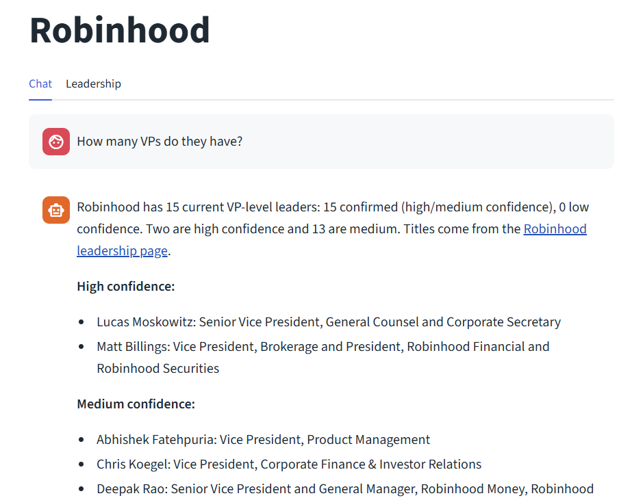
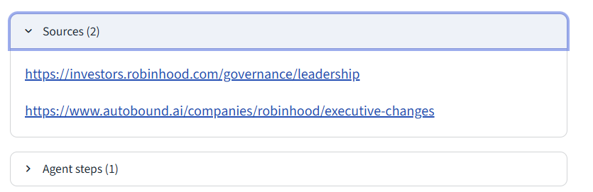
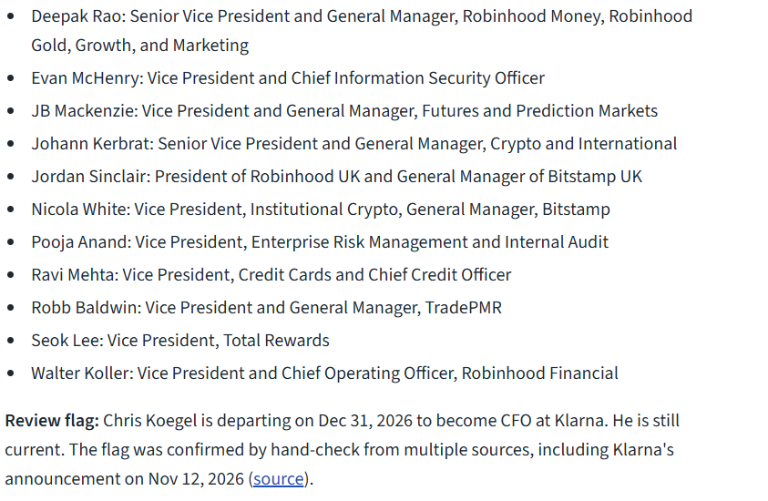
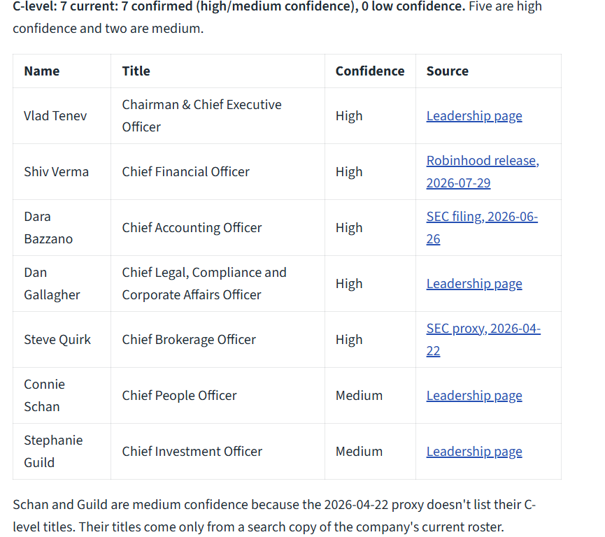
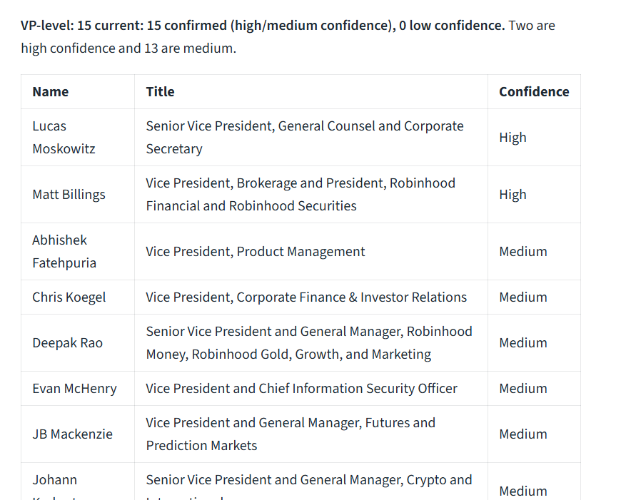
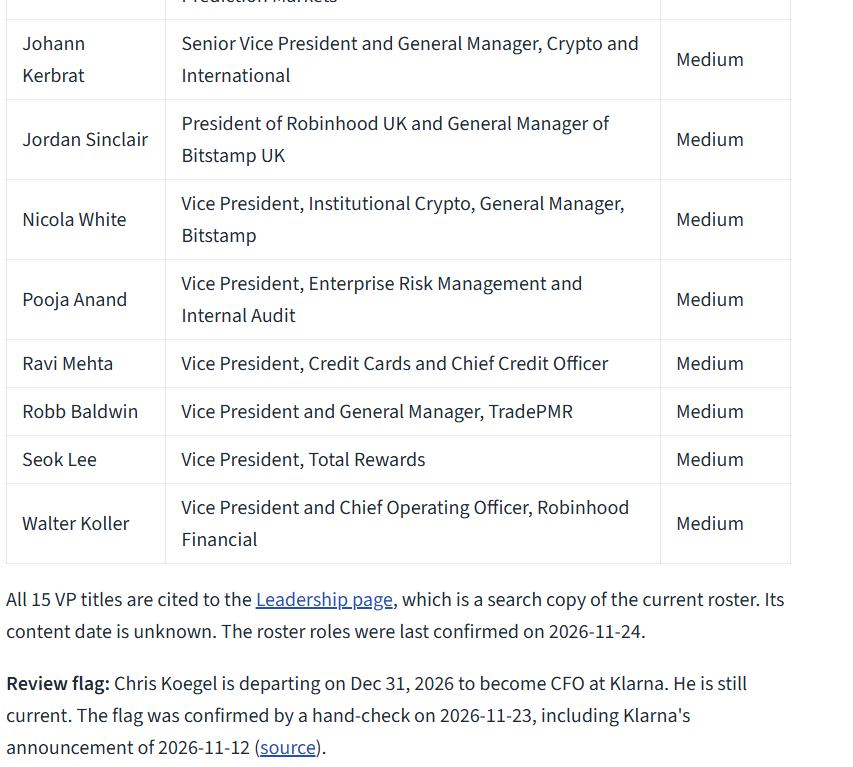
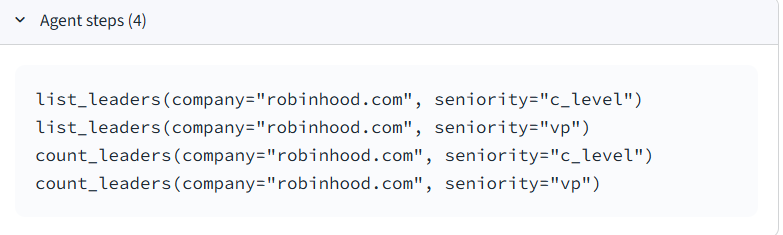
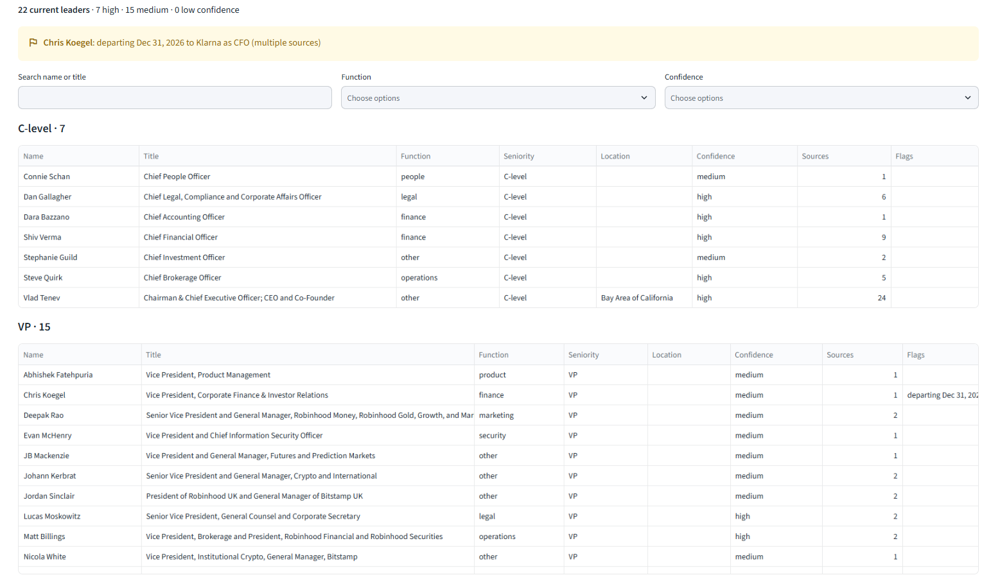

# Company Leadership RAG Agent

This project collects a company's public leadership data from three sources: its own website, SEC EDGAR, and one web search API. Every fact keeps its source URL, the exact evidence snippet and a date. Fixed rules decide who is current and how confident each record is, and the result is stored in SQLite. A Claude agent then answers questions over that data through typed, read-only tools: "Who's their CTO?", "How many VPs do they have?", "Where is their CEO based?". It answers only from tool results, cites its sources, says "not found" instead of guessing, and never presents a former leader as current. The repo ships collected, hand-checked data for **Robinhood** (robinhood.com, public) and **Campfire** (meetcampfire.com / campfire.ai, private). Chat, the eval and the UI run against that data with only an `ANTHROPIC_API_KEY`.

- [Quickstart](#quickstart)
- [Screenshots](#screenshots)
- [Architecture](#architecture)
- [Storage rationale](#storage-rationale)
- [Sourcing and ethics](#sourcing-and-ethics)
- [How I validated](#how-i-validated)
- [Cost per run](#cost-per-run)
- [Known limitations](#known-limitations)
- [What I'd do with more time](#what-id-do-with-more-time)
- [How I worked with Claude Code](#how-i-worked-with-claude-code)
- [AI tools used](#ai-tools-used)

## Quickstart

**You need** [uv](https://docs.astral.sh/uv/getting-started/installation/) and an Anthropic API key. uv installs Python 3.12 itself (`.python-version`). The project runs on Windows, macOS and Linux/WSL.

### VS Code (F5)

1. Open the repo folder in VS Code and install the recommended extensions when prompted (Python, Pylance, Python Debugger, Ruff; listed in `.vscode/extensions.json`).
2. In the terminal (Terminal > New Terminal), run `uv sync`.
3. Copy `.env.example` to `.env` and set `ANTHROPIC_API_KEY`.
4. Open Run and Debug, pick **Launch UI**, and press **F5**.
5. Open http://localhost:8501. No browser opens by itself, and there is no first-run prompt.

`.vscode/launch.json` also has **Collect robinhood.com**, **Collect meetcampfire.com**, **Chat CLI**, **Eval** and **Debug tests**.

### Terminal

```bash
uv sync
cp .env.example .env          # Windows (cmd): copy .env.example .env
# edit .env and set ANTHROPIC_API_KEY
uv run leadership ui          # then open http://localhost:8501
```

The UI is served on localhost only. Without `ANTHROPIC_API_KEY`, the Leadership tab still works and chat shows how to add the key.

### Other commands

| Command | What it does | Keys needed |
|---|---|---|
| `uv run leadership chat robinhood.com` | Terminal chat (`-q "question"` to ask and exit) | `ANTHROPIC_API_KEY` |
| `uv run leadership eval` | Runs the 22 eval cases through the real agent (about $0.23). A full run rewrites `eval/RESULTS.md`; `-c <case id>` or a company runs a subset without touching it | `ANTHROPIC_API_KEY` |
| `uv run pytest` | 238 offline tests; no keys, no network | none |
| `uv run leadership collect robinhood.com` | Re-collects a company: discover, extract, validate, resolve, store | `ANTHROPIC_API_KEY`, `TAVILY_API_KEY`, `SEC_USER_AGENT` |
| `uv run leadership validation-report` | Regenerates `docs/VALIDATION.md` and keeps the hand-check ticks | none |

**Re-collecting:** per-company settings live in `data/companies.yaml` (Robinhood: `ticker: HOOD`; Campfire: `private: true`, `max_pages: 120`). A bare `collect` therefore reproduces the committed data; flags such as `--ticker` and `--max-pages` override it (D41). The raw page cache isn't committed (D14), so a fresh clone re-fetches live pages. Those pages may have changed since 2026-11-24, and the results can differ.

## Screenshots

**1.** Chat tab: "How many VPs do they have?" gives 15 current, with the confidence split (2 high, 13 medium, 0 low) and a cited source.



**2.** The answer's collapsible Sources and Agent steps.



**3.** The rest of the VP list, ending with the review flag: Chris Koegel is departing Dec 31, 2026 to Klarna, and is still current.



**4.** A broader question answered as tables: 7 current C-level leaders, each with confidence and a linked source, and why two are medium confidence.



**5.** The same answer's VP table (15 current).



**6.** The end of the VP table: the roster's dating caveat and the Koegel flag.



**7.** The Agent steps for that answer: the four typed tool calls the agent made.



**8.** Leadership tab: 22 current Robinhood leaders (7 high, 15 medium, 0 low confidence), the Koegel review flag, search, function and confidence filters, and tables grouped C-level / VP with title, function, location, confidence, source count and flags.



## Architecture

```mermaid
flowchart LR
    subgraph Sources["Sources (sources/)"]
        S1["Company site<br/>sitemap + ranked pages"]
        S2["SEC EDGAR<br/>DEF 14A, 10-K, 8-K 5.02"]
        S3["Web search<br/>Tavily, 10 queries"]
    end
    Sources --> F["Fetcher<br/>robots.txt, 1 req/s per host,<br/>LinkedIn banned"]
    F --> C[("Raw cache<br/>data/&lt;domain&gt;/raw/<br/>(not committed)")]
    C --> P["Keyword pre-filter"]
    P --> X["Extract<br/>Claude, structured output,<br/>cached per document"]
    X --> V["Validate<br/>evidence literal in page,<br/>names company, scope rules"]
    V --> R["Resolve<br/>identity, currency,<br/>confidence (deterministic)"]
    R --> DB[("SQLite<br/>leadership.db + .json<br/>facts / people / roles")]
    DB --> T["Tools (chat/tools.py)<br/>list_leaders, count_leaders,<br/>get_person; read-only"]
    T --> A["Agent (chat/agent.py)<br/>Claude tool loop,<br/>prompt caching"]
    A --> UI["Streamlit UI<br/>leadership ui"]
    A --> CLI["CLI<br/>chat, eval"]
```



- **Sources (`src/leadership/sources/`):**
  - The company site is crawled from its sitemap. URLs are ranked by people words in the slug and link text, and the top N are fetched (D26).
  - SEC EDGAR provides the latest proxy (the authoritative officer list), the 10-K and 8-K Item 5.02 departures (D11, D21).
  - Tavily runs 10 targeted queries and returns page text (D7).
  - Every adapter returns what it skipped and why, so a blocked or empty source shows in the output (D12).
- **Extract (`pipeline/extract.py`):** Claude reads each page that passes the pre-filter. It returns name, title, location and a status of current / former / incoming / unclear, each with an evidence snippet. Responses are cached per document and prompt version (D17).
- **Validate (`pipeline/validate.py`):**
  - The snippet must appear literally in the page, and must contain the person's name and title.
  - It must state an affiliation with *this* company (D22).
  - A location must say where the person lives or works (D34).
  - Titles outside scope (advisors, directors and below) are dropped (D27).
- **Resolve (`pipeline/resolve.py`):** deterministic, with no LLM.
  - A narrow same-person rule (D6) plus hand-curated merges (D33).
  - Currency: "former" wins unless a newer current claim exists; the proxy decides C-level; a single source older than 18 months is not current (D16, D32).
  - Confidence is set from the sources' type, count and dates.
- **Storage (`storage/`):** `schema.sql` plus a repository that enforces provenance on every write (D3).
- **Chat (`chat/`):**
  - Three typed tools on a read-only SQLite connection.
  - A manual tool-use loop with adaptive thinking, prompt caching, and history trimmed to the answers (D36, D39).
  - Optional streaming for the UI (D43).

## Storage rationale

**SQLite, relational, not a vector store (D2).**
- The questions are structured: filter by role, count, look up a field. A relational model answers them exactly, while similarity search over pages makes counts and filters approximate.
- SQLite needs no server, so the repo works right after cloning.
- The schema avoids SQLite-only features, so a move to Postgres is a small change.

**Facts are separate from the resolved view (D3).**
- `facts` keeps every claim: field, value, source, evidence snippet, date.
- `people` and `roles` hold the resolved current view.
- So the agent can show every source for a title and point out where sources disagree, and nothing reaches `people` or `roles` without a backing fact.
- The repository raises `ProvenanceError` when a write has no matching fact.

**Committed per company:** `data/<domain>/leadership.db` and a readable `leadership.json` export. Hand decisions live next to them: `review_flags.json` (D28) and `identity_merges.json` (D33).

## Sourcing and ethics

- **No LinkedIn (D1).** Its User Agreement prohibits scraping. The fetcher refuses linkedin.com outright, search results from it are excluded, and no LinkedIn URL is stored. The same goes for profile aggregators (ZoomInfo, RocketReach, Crunchbase, theorg.com and others; D8). The cost is weaker coverage of VPs and department heads, which is measured below.
- **robots.txt (D8):**
  - It is checked before every request, including each redirect hop. Redirects are followed by hand so a hop is checked before it is requested.
  - A 401/403/5xx or unreachable robots.txt means stay out.
- **Rate limits:** one request per second per host, and a descriptive User-Agent. SEC requests use the `SEC_USER_AGENT` you provide, as SEC policy requires.
- **Bot-blocked hosts (D13):**
  - investors.robinhood.com returns Akamai 403 to every automated client, robots.txt included. We don't work around it: no browser User-Agent and no headless browser.
  - We keep the copies of its pages that Tavily returned, at the lowest trust level (`source_type=search`), and mark them for a manual browser check.
  - A search copy's content date is unknown, so it can never outweigh a dated "former" statement (D38).
- **The UI is bound to localhost** (`server.address = "localhost"`, D43). It isn't reachable from the network, and it sends no usage statistics.
- **No redistribution (D14):** the raw cache (full copies of third-party pages and filings) is gitignored. Only short evidence snippets are committed.
- **Personal data:** only professional facts are collected: name, title, work location, a short bio. Questions about salary, email, age and the like are answered "not found" (eval cases rh-salary, rh-email, cf-age).

## How I validated

Validation was treated as a feature. The full record is in [docs/VALIDATION.md](docs/VALIDATION.md), the decisions in [docs/DECISIONS.md](docs/DECISIONS.md), and the eval in [eval/RESULTS.md](eval/RESULTS.md).

**Subagents (in `.claude/agents/`).** Their reports were inputs to my review, not approvals. No data was changed on a subagent's finding without my decision.

| Subagent | Role | Result |
|---|---|---|
| `phase-reviewer` | Read-only review of every phase's diff | 3 BLOCKs (Phases 1, 2, 3), plus PASS WITH FIXES on most rounds; every phase ended on PASS ([below](#how-i-worked-with-claude-code)) |
| `coverage-scout` | Blind web research on each company's leadership, never shown our data | Robinhood: 2 misses (Erika Dean, Katelyn Perna), fixed by a general crawler-ranking fix (D26); no known misses remain. Campfire: no misses. |
| `source-verifier` | Checks every stored fact against its cached and live source | Evidence supported: Robinhood 51 of 60 records, Campfire 23 of 24. I hand-checked every disputed record. |
| `fresh-clone-tester` | Clones the repo, follows this README literally, runs tests, eval and a UI health check | READY TO SUBMIT on the final commit (offline: 238 tests, UI health check, keyless-eval behaviour, secret scan of the repo, `session/` and git history, deliverables). The real eval ran separately: 22/22. |

**Hand-check (2026-11-23).**
- I checked every record in `VALIDATION.md` in a browser.
- Each row has an agent verdict next to my "Verified by Daniel" column, and the ticks survive regeneration.
- Errors found, with causes and fixes:
  1. **Eight stale "current" leaders.** All 8 Robinhood roles that rested on a single source older than 18 months had ended, and so had the one such Campfire role (Fernando San Martin, shown as CTO). That is 8 of 8 and 1 of 1. The old rule only lowered their confidence. The new rule (D32): a single source older than 18 months is not current unless a newer source confirms it. Robinhood went from 31 to 22 current, and Campfire from 9 to 8.
  2. **One person stored twice.** "Steph Guild" and "Stephanie Guild" were two records. Fixed with a hand-curated merge backed by her bio (D33).
  3. **A filming location taken as residence.** Vlad Tenev's "San Francisco" came from a CNBC caption about where an interview was filmed. A location must now say where the person lives or works (D34). His board bio's "Bay Area of California" is kept.
  4. A display gap hid a historical role's seniority in VALIDATION.md (Anne Hoge).
  5. Koegel's departure flag was upgraded from "unconfirmed" to "multiple sources" (D28).
- **Live-page check:** the live investors.robinhood.com/governance/leadership page, opened in a browser, matched our current Robinhood list. Every VP and above is in the data. Out-of-scope people are correctly excluded, and Norm Ashkenas, who isn't on the page, is correctly not current.
- **Two false alarms:** AI-assisted research flagged two people as departed, based on stale search snippets. The live page showed both were current (see [AI tools used](#ai-tools-used)).

**Eval:** 22/22 passed with the real agent, for $0.23 (`eval/RESULTS.md`).
- **Cases:** 10 per company (each Robinhood or Campfire chat, including one asking about Stripe from a Robinhood chat) plus 2 with no company selected. They cover the four example questions, "not found" questions (salary, email, revenue, age), follow-ups, a source conflict (Jason Warnick), low confidence, a departure flag (Koegel), asking which company, and declining an uncollected company.
- **Grading** is deterministic: regexes, required tool calls with arguments, and citations (D40). `verified_by` in `eval/questions.yaml` records who hand-checked each expected answer.

**Unit tests:** 238 offline tests, with no keys and no network. They cover title rules, evidence checks, identity and currency resolution, provenance enforcement, the repository queries, the chat tools and agent loop, the eval grader, the config, and the UI (Streamlit AppTest).

## Cost per run

Model: `claude-sonnet-5-5`. Collection costs are from `collection_runs.stats_json`; chat costs are from the agent's token counts.

| Run | Cost |
|---|---|
| Collect Robinhood (82 documents, 67 sent to the LLM) | $0.65 in LLM calls, plus 10 Tavily credits. SEC EDGAR is free. |
| Collect Campfire (114 documents, 101 sent to the LLM) | $0.67, plus 10 Tavily credits |
| Re-collect with a warm cache | $0.00, with 0 network requests (all responses cached) |
| One chat question | About $0.01–0.03 with prompt caching: Campfire "Who's the CFO?" $0.018, the Robinhood "and the CFO?" follow-up $0.025, eval average about $0.01 per case. A question that pulls a large `get_person` result sends about 50k prompt tokens and costs more. |
| The full eval (22 cases) | $0.23 |

Prompt caching and history trimming (D39) cut a five-question conversation from $0.39 to $0.16.

## Known limitations

- **VP and department-head coverage is limited** because LinkedIn is not a source (D1). Many such people appear only there.
- **Robinhood's VP list rests on search copies** of a bot-blocked page (D13). They are medium confidence, and their content date is unknown. The live page matched on 2026-11-23, but that can change.
- **Campfire has little authoritative data.** As a private company it has no SEC filings, so most roles come from blog bylines. Both VPs are low confidence (single undated sources).
- **Currency rules are heuristics:** the 18-month rule, "former" wins, the proxy decides C-level. They matched the hand-check, but a long-tenured leader who is rarely mentioned could be retired wrongly.
- **Identity matching is narrow on purpose** (D6). Name variants beyond prefixes and a small nickname map need a hand-curated merge (D33). The prefix rule could merge "Chris Lee" and "Christine Lee" if their functions overlap.
- **Locations are sparse,** because the location check requires "lives in", "based in" and similar wording (D34). Most leaders have no location, and the agent says so.
- **Review flags are hand-curated** (Koegel's departure). The pipeline doesn't detect announced future departures itself.
- **The eval does not check every claim.** `leadership eval` checks answer patterns, the tool calls made, and that the answer cites a source the tools returned, so a wrong detail can still pass. For example, one passing rh-marketing answer said Deepak Rao's profile page is dated by its retrieval date, but only roster pages are. The `expected` text for each case is there for the hand check.
- **Re-collection isn't offline-reproducible from a clone,** because the raw cache isn't committed (D14). It needs all three keys and fetches the live pages again.
- **JavaScript-rendered pages are invisible.** There is no headless browser, so Robinhood's newsroom index yields no link text (D26).

## What I'd do with more time

- **Scheduled re-collection with diffs:** re-run weekly and report new, departed and changed leaders. A departure would surface as a flag instead of waiting for the 18-month rule.
- **Detect announced departures and appointments automatically.** 8-K Item 5.02 is parsed already; extending it to news ("joins X as CFO") would remove the need for hand-curated flags.
- **More authoritative sources for private companies:** press-release wires and conference speaker pages, each with its own ToS review.
- **A model-graded check alongside the deterministic eval,** for claim-level accuracy (the Deepak Rao example above), with the regex grader kept as the gate.
- **Smaller tool results:** trim `get_person` output to the fields a question needs. A CEO-location turn is still about 51k prompt tokens.
- **Postgres and multi-company scale:** the schema is ready (D2). Next would be a company registry and a collection queue.

## How I worked with Claude Code

**The loop, every phase:**
1. Claude proposed the plan (Phase 0: plan, schema, open questions) and waited for my approval.
2. It built one phase.
3. It ran the phase on real data and showed the output.
4. It ran `phase-reviewer` on the diff and fixed findings until the verdict was PASS.
5. It listed what it was unsure about.
6. It stopped for my review.

Each non-trivial decision went into `docs/DECISIONS.md` with the rejected alternative. Decisions I made are marked "decided by Daniel". The phases were: storage, source adapters, extract/validate/resolve, collection + validation (with a stop for my hand-check), chat agent, eval, UI, and docs.

**Reviewer verdicts** (`phase-reviewer`, in order):

| Phase | First verdict | Final |
|---|---|---|
| 1. Storage + schema | BLOCK: a person could be stored without evidence | PASS |
| 2. Source adapters + cache | BLOCK: redirects were followed before the target was checked against robots.txt and the LinkedIn ban (D8) | PASS |
| 3. Extract + validate + resolve | PASS WITH FIXES; then BLOCK on my follow-up decisions (re-anchoring could pick up a neighbour's title on real data) | PASS |
| 4. Validation report, scout, verifier | PASS WITH FIXES | PASS |
| Post-Phase-4 decisions, D30, hand-check fixes (D32–D35) | PASS WITH FIXES on each of the three changes | PASS |
| 5. Chat agent | PASS WITH FIXES | PASS |
| 6. Eval + D37–D42 | PASS WITH FIXES (2 rounds) | PASS |
| 7. UI | PASS WITH FIXES (a streaming interruption could corrupt the chat history) | PASS |

**Where I pushed back:**
- **General Counsel (D4).** Claude's first rule made every General Counsel C-level, which gave Robinhood two legal chiefs. I changed it so the proxy decides.
- **Combined titles (D37).** For "CEO & CFO", Claude read the CFO seat from the title wording at query time (`also_titled`), and left splitting the row to me because it would change approved data. I required one role row per seat, each with its own sources, so "Who's the CFO?" is answered directly.
- **Roster dating (D38).** Claude treated the undated roster page as undated, which left 10 Robinhood VPs at low confidence. I had a current roster listing dated by when it was retrieved. Claude then added, and I approved, a guard that a search copy never outweighs a dated "former" statement.
- **Reproducibility (D41).** Claude's plan was to document the collect flags in the README. I asked for a per-company config so a bare `collect` reproduces the data.
- **Process.**
  - I had Phase 6 re-reviewed until it ended on a plain PASS.
  - I asked for prompt caching and history trimming, with before/after token counts (D39).
  - I had the UI's first-launch prompt removed and the server bound to localhost.
- **My hand-check changed rules:**
  - My own 18-month rule only lowered confidence, and the 8-of-8 finding replaced it (D32).
  - The source-verifier's flag on a CNBC filming location led to a stricter location rule (D34).

### Planning & setup (summary — not a transcript)

Before building, I used Claude (claude.ai) to plan the approach and draft the Claude Code prompt. Key decisions from that planning:

- **Sourcing:** company site → SEC EDGAR → Tavily search. **LinkedIn excluded** because its ToS prohibits scraping; the coverage trade-off is accepted and documented in `docs/DECISIONS.md`.
- **Storage:** SQLite, relational, Postgres-compatible schema, with a `facts` table recording every claim alongside its evidence. A vector store was rejected because the target questions are counts and filters.
- **Scope cut after the hiring team's guidance** ("keep it simple", "validate what the agent produces"): removed Wikidata, an LLM verifier step, a separate title-normalizer LLM step, a raw-SQL chat fallback, and UI-triggered collection. Added an exact-match check that rejects any extraction whose evidence snippet doesn't appear in the source text, plus a human validation checklist.
- **Validation subagents** (`.claude/agents/`): `phase-reviewer`, `coverage-scout` (blind, with no way to read project files), `source-verifier`, and `fresh-clone-tester`. They're written as read-only reviewers so the build agent's work is checked by agents that didn't produce it. Their reports are inputs to my review, not approvals.
- The final prompt is saved at `docs/initial-prompt.md`.

**Setup issues I hit with Claude Code, and how they were resolved:**

1. **Cloud session couldn't reach local files.** My first attempt ran in a cloud Claude Code session, which couldn't see the files on my PC. I switched to Claude Code running locally in VS Code, which also keeps API keys on my machine and out of the session export.
2. **Setup landed in a temporary folder.** The first local run initialized git and committed in a temporary session folder. Only some files were copied to the project folder, without `.git` or `.claude/`. I caught this when the agents didn't appear in VS Code, and redid the setup directly in the project folder.
3. **The `.env` safety check stopped the commit.** Claude Code was told to verify that `.env` was git-ignored before committing. The check failed because `.gitignore` hadn't been created yet, so it stopped instead of committing, and I approved adding `.gitignore` first.
4. **Agent read access to `.env` wasn't blocked at first.** Reviewing the commit showed `.claude/settings.json` was missing, so I added a deny rule that stops Claude Code from reading `.env`.
5. **Plugin agents restricted.** My globally installed plugin agents were also available in the session. I told Claude Code to use only the four project subagents, so that all production code comes from the main session.
6. **Phase 0 plan review.** I approved the plan with changes. I removed two stored fields that could be derived instead (`source_priority`, `source_count`) and rejected a new `exec` seniority category in favor of mapping President and General Counsel to `c_level`.

**Session history note:** the early setup sessions (items 1–4) weren't preserved; their output is visible in the git history (scaffolding commit `b155ed7`). The full build, from the Phase 0 plan onward, is exported in `session/`.

## AI tools used

- **Claude Code** did all the development: code, tests, data collection runs and docs, with the four project subagents above. The session export is in [`session/`](session/).
- **Claude (claude.ai)** drafted the initial prompt ([docs/initial-prompt.md](docs/initial-prompt.md)) and assisted with stale-record research during the hand-check. I confirmed every link it gave. It also produced two false "departed" flags from stale search snippets, which my live-page check caught.
- **Session-export note:** the SessionStart/PreToolUse hook errors in the session come from an unrelated global plugin, not from this project.
